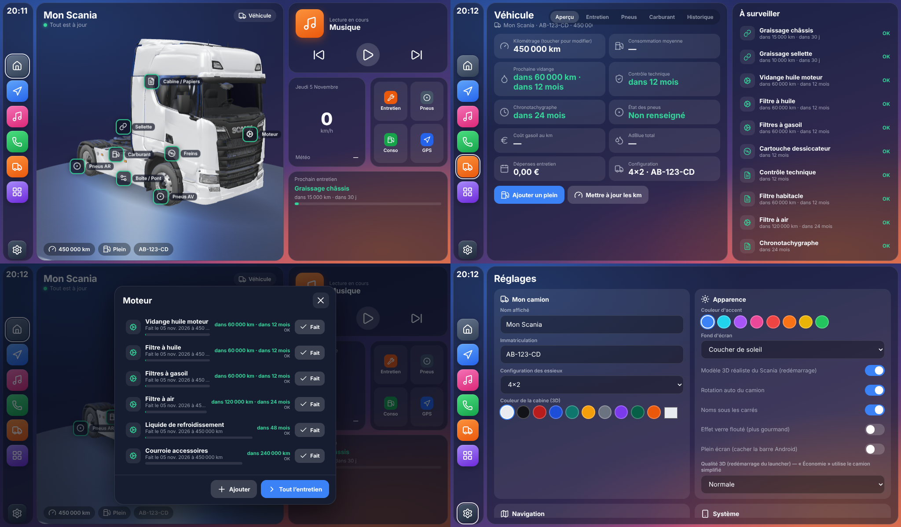

# Launcher Scania

Launcher Android pour autoradio (testé pour Junsun V1 Plus) façon Android Auto / CarPlay, pensé pour un camion :

| Écran | Contenu |
|---|---|
| **Accueil** | Camion 3D sur podium tournant (on le fait pivoter au doigt) avec des **petits carrés cliquables** : Moteur, Cabine/Papiers, Freins, Pneus AV, Boîte/Pont, Carburant, Pneus AR, Sellette. Chaque carré est vert / orange / rouge selon l'état. + carte musique, vitesse GPS, météo, prochain entretien. |
| **Navigation** | Carte intégrée avec ta position et ta vitesse, recherche d'adresse → itinéraire **Google Maps** ou **Waze**, destinations favorites (Maison, Dépôt…). |
| **Musique / Téléphone** | Boutons directs vers l'appli musique et l'appli téléphone Bluetooth de l'autoradio. |
| **Véhicule** | Onglets Aperçu, Entretien, Pneus, Carburant, Historique + liste « À surveiller ». |
| **Applications** | Toutes les applis installées, avec favoris en grand (appui long pour ajouter/retirer). |
| **Réglages** | Nom, immatriculation, essieux (4x2, 6x2, 6x4), couleur de la cabine 3D, thème, clé Google Maps, sauvegarde. |

Pas de bus CAN : tout se saisit à la main (kilométrage, pleins, entretiens, pneus). Le kilométrage se met aussi à jour quand tu enregistres un plein ou un entretien.

## Installer sur l'autoradio

1. Sur GitHub, onglet **Actions** → dernier « Construire l'APK » → télécharge l'artefact **LauncherScania-apk** (un zip contenant `LauncherScania.apk`).
   Si tu crées un tag `v1.0.0`, l'APK est aussi publié dans **Releases**.
2. Copie `LauncherScania.apk` sur une clé USB, branche-la sur l'autoradio et installe-le avec le gestionnaire de fichiers (autorise les « sources inconnues » si demandé).
3. Appuie sur le bouton **Home** : Android demande quel launcher utiliser → choisis **Launcher Scania** → « Toujours ».
   Sur certains Junsun/FYT, le launcher par défaut se choisit dans *Paramètres → Applications → Applications par défaut → Appli d'accueil*, ou via *Réglages du launcher → Système → Launcher par défaut*.
4. Accepte la permission de localisation (vitesse, carte, météo).

Pour revenir au launcher d'origine : *Paramètres Android → Applications par défaut → Appli d'accueil*.

## Utilisation

- **Carrés sur le camion** : touche un carré pour voir les entretiens de la zone, cliquer « Fait » quand c'est fait (kilométrage, date, coût, note).
- **Entretien** : intervalles en km et/ou en mois, barre de progression, statut OK / Bientôt / À faire. Tous les intervalles par défaut sont **indicatifs** : modifie-les selon ton carnet d'entretien (touche une ligne).
- **Pneus** : schéma vu de dessus, chaque pneu a sa marque, sa dimension, le km de montage, la durée de vie estimée, la profondeur de sculpture et la pression.
- **Carburant** : saisis chaque plein (km, litres, prix, AdBlue). La consommation est calculée **de plein complet à plein complet** (L/100 km), avec graphique, coût au km et ratio AdBlue.
- **Sauvegarde** : Réglages → Exporter (fichier JSON dans *Téléchargements*) / Importer.

### Google Maps intégré
Sans rien configurer, l'écran Navigation affiche une carte libre (OpenStreetMap) et lance **Google Maps** ou **Waze** pour le guidage.
Pour avoir la **vraie carte Google (avec trafic)** directement dans l'écran, crée une clé « Maps JavaScript API » sur Google Cloud et colle-la dans *Réglages → Navigation*.

## Développement

- `web/` : interface (HTML/CSS/JS, Three.js pour la 3D, Leaflet pour la carte). `cd web && npm install && npm run build` génère `app/src/main/assets/web/`.
  Pour tester dans un navigateur : `cd app/src/main/assets/web && python3 -m http.server`, puis ouvrir `http://localhost:8000` (fenêtre 1024×600).
- `app/` : application Android (Kotlin) : un WebView plein écran + un pont `Android` (liste/lancement des applis, icônes, navigation, touches média, sauvegarde).
- L'APK est construit automatiquement par GitHub Actions (`.github/workflows/build.yml`), ou en local avec Android Studio.
